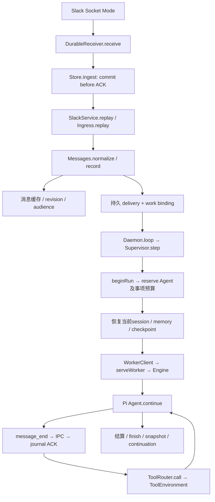

> 2026-09-21：E1–E3已完成平台无关会话、投影、动态配置、参与和有界历史；E4a补齐协作恢复面，E4b补齐owner安全状态/activity。E4c 工具组合仍待实现。当前阶段与债务见IMPLEMENTATION_PLAN和ARCHITECTURE。

# Mate 当前调用链、能力与边界

2026-09-20，R1–R8 已逐模块通过独立红队，最终验收见 [ACCEPTANCE](ACCEPTANCE.md)。本文件描述当前代码；[PROJECT_DIRECTION](PROJECT_DIRECTION.md)解释为何重构，[实施计划](IMPLEMENTATION_PLAN.md)与[审核记录](reviews/)保留各 gate 的证据。

验收只问：假设模型足够智能，工具、环境、prompt 和状态机是否允许它实现目标，并在并发、重启、失败时保持契约。脚本化模型用于选择分支，不是模型性能评测。

## 从输入到模型，再到工具



入口：[main](../src/main.ts)、[Daemon](../src/daemon/app.ts)、[Supervisor](../src/runtime/supervisor.ts)、[Engine](../src/runtime/engine.ts)。Pi Core + pi-ai 是实际运行层，没有 pi-coding-agent。

同一 Agent 的频道、thread、DM 输入使用同一个当前 session 和 worker；不同 Agent 分开。SQLite 保存原始 journal、恢复 snapshot、队列和回执。每 Agent 同时只有一个主 run；普通输入排队，同时 content-free notice 在下一模型调用边界注入当前 run，不强杀正在执行的工具。owner stop 则走独立 abort/fence 路径。

Notice、读取、处理彼此独立。消息到达或进入 inbox 不等于正文已呈现；finish 不等于解决未读问题。模型通过 attention.read 按需获取正文，通过 defer/resolve/mute/watch 管理注意力。

历史读取也不等于处理。`history.page/search/around` 在当前 ACL 下查询本地 canonical 缓存；`history.fetch` 通过行动 Agent 自己的 installation 有界补一页外部历史。回填只补正文/revision/visibility并使旧 freshness view 在必要时失效，不写 observation、delivery、seen 或 resolved。每次结果明确给出 scope、continuation 和 gap；详见 [HISTORY](HISTORY.md)。

## 可见性、事项、任务和预算不是同一个对象

| 对象 | 用途 | 不会自动发生的事 |
|---|---|---|
| Agent / current session | 持久身份和当前上下文 | 换 session 不创建新身份、不清预算 |
| Target | channel、可选 thread；DM也是channel ID | 不是独立Agent上下文 |
| Work | 动作控制、事项额度、run归属 | 不是所有读取操作的ACL，也不是必须采用的任务树 |
| Canonical task | 原消息上的所有权、版本和状态 | 不因重复create生成同一消息的第二个owner |
| Agent budget account | 持续 runs/tokens/cost，预留与结算 | 新人类消息、peer消息、work或reset不补额 |
| Grant | 特定Agent/事项/root的read/write/exec授权 | 消息或memory文本不能扩大权限 |

[BudgetLedger](../src/budget/ledger.ts)先预留、后按可信 usage 结算；未知 usage 保留预留债务。一次 run 的模型费归起始事项和Agent；works.select 切换后续动作与控制归属，并获取新事项 grants，不改写既有账单。事项耗尽不会暂停整个Agent，其他事项仍可调度；Agent账户耗尽需要owner提高累计上限。配置预算只首次播种账户。

读取按当前可见性；跨事项任务读取和同伴讨论可达。曾读过的私有频道内容仍可能保留在这个Agent的共同上下文中；撤销ACL防止新工具读取，并不使模型忘记旧内容。

## 消息门控如何保留自主判断

[Attention](../src/slack/attention.ts)维护本地 observed revision、分页快照和 viewToken。新增、编辑、删除、晚到消息、可见性变化都形成事件。完整 toolResult 随 journal 提交后才ACK呈现；搜索、metadata、半页、未ACK结果不能充当完整视图。token绑定Agent/session/epoch/target/revision，压缩和session更换后失效。

```text
attention.read → 完整呈现ACK → viewToken
messages.send / artifact.publish / task mutation
  ├─依据仍有效 → queued / 接受任务变更
  └─依据缺失或过时 → held draft / task intent，无提交副作用
       ├─读取后 retry（再次检查）
       ├─revise（新不可变版本）
       ├─discard / 保留、暂缓
       └─continue（当前hold+revision，有限知情继续）
```

[FreshnessGate](../src/slack/freshness.ts)不评价内容质量，不审查命令。continue只跨越freshness，不跨ACL、task CAS、停止或unknown。消息continue绑定60秒内一次派发机会，超时重新hold，不成为永久“忽略变化”。

[Output.ready/sendNow](../src/slack/messages.ts)在真正派发前再检查：owner/Agent/work状态、当前ACL、相关未规范化ingress、unknown/sending阻挡和freshness。429后重查；网络丢回执转unknown，不自动重发。阻挡条件在LIMIT前过滤，避免一个频道饿死其他频道。派发目前全局串行，强于按目标串行，吞吐量相应受限。

Slack没有这里所需的“比较整个房间版本后原子发送”事务。保证覆盖本地已观察状态；外部消息可在本地检查之后到达。完整调研与来源见[MESSAGE_GATING_RESEARCH](MESSAGE_GATING_RESEARCH.md)。

## 直接协作、消息任务和提醒

直接路径：A messages.send @B → gate/outbox → confirmed → Messages.record → B持久delivery → B下一run。无需总管、父任务或委派树；自己的echo去重。同伴可以选择回复、核实、补充、暂缓或沉默。

需要追踪所有权时，[MessageTasks](../src/coordination/messages.ts)的 tasks.claim 接原始messageRef或既有taskId，唯一message_key加version CAS。所有按taskId的读取和变更都先经过[TaskBoard](../src/coordination/board.ts)的同一可见性判断；external message-task必须有行动Agent自己的installation snapshot，不能只凭频道ACL或猜到ID读取/变更。hold时不提前占有任务；继续也不能抢占另一个owner。unclaim/transfer/update都有版本约束。tasks.create先发可见消息，confirmed后才激活任务；未发布或发布失败的task只向creator、assignee或owner开放。历史无法证明原始消息来源且没有message binding的旧task才标legacy，不猜测合并。

`TaskTransitions`把状态、owner、assignee、等待依赖、message/outbox binding和对应event作为同一事务提交；自动dependency wake、delegation发布/失败、draft revision和work cancel也走同一边界。v22迁移只按唯一create actor、draft outbox actor、assigned actor依次回填createdBy；无法证明时保持unknown，并为旧event写明从哪个version之后才完整。

tasks.list按owned、assigned、available、all-visible分页；cursor绑定actor和查询。每次最多扫描200个候选，即使某页因当前ACL/snapshot全部不可见，也返回scan continuation而不在低配VPS上扫完整表。tasks.events另行分页并返回历史coverage。普通peer review的review状态在claim/unclaim时保留；transfer明确选择继续review或退回doing。独立blind review仍走review seat。tasks.wait建立持久依赖并释放run，等待者仍能处理其他对话。新任务与状态投影是可见信息，不代替Agent自己的讨论判断。

[Reminders](../src/reminders/service.ts)由作者管理content、target、可选anchor/task、时间、cron、version和日志。完成task不取消提醒；事项pause/cancel仍控制其触发。默认`private`只原子写author delivery与firing，不产生outbox、conversation event或peer attention；显式`conversation_receipt`才生成无正文的固定回执。delivery携带firingId；Agent处理后用reminders.finish幂等记录completed、failed或deferred，summary保持作者私有。deferred只描述本次结果，不自动安排下一次唤醒。log分别分页scheduler events与firings，并分开展示delivery、run、receipt和语义result。cancel默认取消未来，显式cancelPending可撤回尚未被run选中的队列，已选中/注入单独报告。

## Owner状态与activity

[OperationsView](../src/operations/view.ts)是local控制入口、Slack `/team`和未来网页共用的owner-only应用服务，认证在service内部完成。`status`直接查询Agent暂停/active run、账户预算、works、unknown action/output、held draft和due reminder的权威状态；DTO只含ID、状态、计数、额度和安全引用，不返回action/outbox request、receipt、run error、task/reminder/result正文、路径或模型输出。`tasks`和`schedules`控制命令也改为相应安全activity视图，不再直接暴露数据库行。

`activity`按时间稳定合并task event、reminder event/firing以及run/action/outbox的安全状态投影。查询可按source、actor和kind过滤；opaque cursor绑定完整查询并分别保存各source的位置，返回每个source的continuation和coverage。旧action/outbox没有可信时间，因此v23保持`created_at=NULL`并报告gap，不用迁移时刻伪造历史。task和reminder的旧记录也沿用各自baseline/legacy coverage。

只有缺少已有事件来源的internal DM创建元数据和run完成/失败/中断写入`operational_facts`。fact不存DM正文、参与者列表、工具参数、receipt、错误、私有memory或模型输出；唯一source key支持幂等，写入失败会回滚同事务中的DM或run状态变化。读取status/activity不写event、delivery、outbox或attention，也不唤醒Agent。未来投影到保留频道时仍需adapter选择category和公开级别；核心不会自行创建或发送该频道。

## 工具与执行的实际路径

| 能力 | 调用链 | 当前契约 |
|---|---|---|
| 发现 | ToolEnvironment.list/describe/execute | 精确Zod schema；可信host adapter可扩展，模型不能安装adapter |
| 交流空间 | ToolRouter → Directory → acting Slack client | 已加入空间/成员/DM；权限变化重查，有界分页 |
| 历史 | ToolRouter → ConversationHistory → 可选 HistorySource | 本地分页/搜索/around；acting installation有界回填；quiet ingestion与明确coverage/gap |
| 文件 | ToolRouter → Broker → SandboxBackend → 固定SRT helper | read/list/stat/search/write/edit/move/remove/mkdir及binary；root/symlink检查 |
| shell | Broker → ControlledBackend → ContainerBackend | 固定本地镜像、单授权root、可停止/恢复，无host credentials/socket挂载 |
| 已知URL | Research.read | allowlist公共HTTPS IPv4、无cookies、重定向/DNS检查；不是搜索服务 |
| 附件输入 | Attachments.save → acting files.info/download → Broker.write_bytes | visible message中的fileId；下载前后ACL/运行状态检查；不接受模型任意URL/token |
| 附件输出 | Artifacts → immutable outbox/draft → staged upload → share | 冻结内容；分享前重查；fileId/phase持久化，unknown按分享证据对账 |
| 历史执行 | actions.list/read | 只当前Agent；执行请求/回执可查，其他对象通过当前ACL工具读取 |

[Broker](../src/policy/broker.ts)是参数规范化、grant、work/stop、持久action和执行边界。未知写操作保守阻挡相关root的后续变更；未知exec阻挡该Agent后续变更，仍可读取核实。不能以新action ID或换session绕过。

私有workspace是通用工作空间，MEMORY.md只是恢复入口。配置Docker后私有root可exec；镜像决定真实工具链。network默认none，owner可选bridge，后者包含可路由局域网及互联网，并非“仅公网”。review seat强制none。镜像不会自动拉取。

当前大小限制：file.read 64KiB；文本写/编辑/文件搜索对象最高1MB；binary read每次32KiB；write_bytes/附件输入/二进制发布最高1MB，文本发布64KiB。工具限制不等于任意模型都能一次消费最大结果：每run最多50,000保守token额度（JSON字节估计）且还受provider context限制；大文件宜search、分块或exec提取后读取。保留文件内容，输出截断有明确标记。

Jev、分类SDK、逐命令审批和相关配置已移除。未来命令审查可在Broker准备/执行之间加入独立决策adapter和持久等待状态，重用action identity、grant验证、可替换ExecutionBackend与恢复机制；当前没有伪实现或隐式审查。消息门控与其分离。

## Session演进、角色与恢复

[完整prompt](../src/runtime/prompt.ts)描述持续同伴、自主注意力、真实人类/peer工作输入、自由知识组织、复用消息任务、进展/交接、跟进与收据。角色可通过对话和memory演化；配置身份、授权不随文本改变。

每run读取最新MEMORY入口；压缩时 Engine → invalidateViews → refreshRecovery RPC → Supervisor重新读取memory、checkpoint、当前选中事项、TaskBoard分类摘要/coverage/continuation和未知动作引用，下一模型输入使用新包。恢复摘要不复制完整task result。memory/checkpoint各8KB摘录并附hash/截断和完整读取入口；refresh失败则运行失败，不冒充已刷新。原始文件不被截断。MEMORY入口应保持可读且不超过底层64KiB read限制。

sessions.checkpoint保存自述检查点；sessions.reset在run结束或崩溃恢复后替换上下文，关闭旧worker，绑定原事项的continuation，cancelled事项不再续跑，paused不绕过。所有身份/预算/任务/提醒/草稿/未知效果仍保留。owner agent-reset先停止，替换后保持paused，需显式resume。

配置/工具prompt版本变化走[离线迁移](../src/daemon/migrate.ts)：锁 → 验证OLD_CONFIG → 旧容器恢复/fence → 数据库+私有文件备份 → 事务更换baseline并保留history、更新grants和配置快照。角色/model/channels/runtime可改、可新增Agent；已有Slack身份/workspace不可重绑定或删除。撤销/过期grant不复活，removed roots撤权，预算不重置。旧库没有身份快照时，显式legacy选项是owner对旧配置的声明，不是假造机器证据。用法见[README](../README.md)。

## 与参考体验仍有区别

- 前端是Slack；没有Raft自有消息服务的全局提交事务。消息任务可以锚定可见thread消息，不只顶层消息；这是Mate的明确扩展。
- 独立review seat目前由owner在从未运行过的身份和干净workspace启用，隔离所有对话/共享workspace/外部研究，强于仅目标隔离；不自动生成临时review Agent，也不提供选择性资料包。owner提供的role/brief本身仍是输入。
- 没有通用搜索、浏览器、第三方登录/集成目录；已知URL读取、配置镜像里的CLI和可信adapter是现有入口。也没有让模型自行增建身份/扩大grant的入口。
- Slack搜索只查本地可见缓存，历史补抓/目录分页有界；不是整个workspace的完整搜索。大文件/超长频道需有界读取或显式知情继续。
- unknown严格保留；没有通用“自动证明外部效果不存在”或任意owner清账工具。文件可核查、Slack消息/附件有对账路径，证据不足时需明确报告阻塞。
- 单workspace、单daemon、共享SQLite和串行执行/发送。多主机、高吞吐、热加载工具未实现。macOS SRT/Docker边界已实测，其他OS未验。
- 真实Slack/provider尚未接线验收；剩余检查是权限、事件、协议、usage和错误兼容，不是“模型能否自主合作”。
