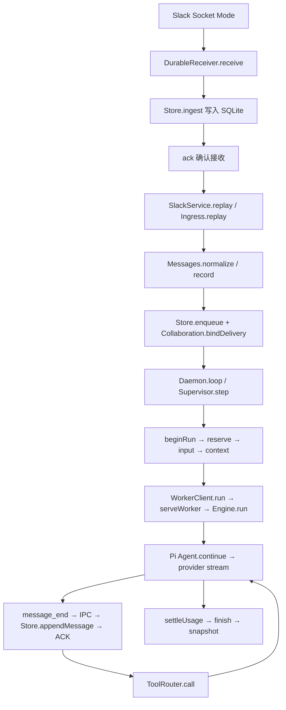

# Mate 当前如何工作，以及还缺什么

2026-09-20，按当前源码梳理。本次已改用 pnpm，并按用户决定删除 Jev、分类器、逐命令审批和精确命令白名单。目录/操作授权、预算、隔离执行与持久回执仍存在。

验收对象是 **harness**：假设模型智能程度无限高，当前工具、环境、system prompt与状态机能否使目标行为可达。脚本化模型是验证调用链的合适测试手段；不要求证明模型是否足够主动、会不会推理或能否提高协作质量。以前“模块 A–G PASS”指模块审核通过，不能理解为原始v1每个产品入口都已接通。

## 1. 从一条 Slack 消息到一次模型运行



具体入口：[`main`](../src/main.ts) → [`Daemon.start/open`](../src/daemon/app.ts)。启动时拿内核文件锁、恢复本实例遗留容器、fence 旧 run、验证 Slack 身份、同步成员资格和补抓消息，再开各 bot 的 Socket Mode 连接。

收到消息后：

1. [`DurableReceiver.receive`](../src/slack/receiver.ts) 先写原始 ingress，再 ack。Slack 重试靠 app/event ID 去重。
2. [`Messages.normalize/record`](../src/slack/messages.ts) 合并消息版本、判断当前可见性、识别注册 Agent/人/外部 bot。明确 @ 和 DM 优先；关注线程可以唤醒；participate 普通讨论按 20 秒窗口合并；自己的 echo 不唤醒自己。
3. [`Ingress.replay`](../src/daemon/ingress.ts) 绑定 work。work 是一条协作链的预算与停止范围；只有可信人类来源可创建新的预算根。Peer 消息沿用已有 work，未能对账的 echo 暂不运行。
4. [`Supervisor.step`](../src/runtime/supervisor.ts) 取一个 delivery，预留预算、提交输入，读取上下文和 memory 恢复包，再发给 Agent 的 worker。通知通常只带消息 ID、来源和 target；模型需要 `messages.read/recent/search` 才取得对应内容，并非每条 Slack 全文都自动塞进上下文。
5. [`Engine.run`](../src/runtime/engine.ts) 调用真实 Pi Core Agent。`message_end` 通过 IPC 等待 SQLite 落盘确认，然后才允许下一步工具调用。结束时还要检查错误/中断状态，不能只看 Pi 已 idle。

模型的设置也属于这条调用链：[`Supervisor.register`](../src/runtime/supervisor.ts) 将身份/role、跨频道同session、显式公开回复、任务委派与等待、memory维护、预算和停止规则写入system prompt；[`operationDocumentation`](../src/runtime/tools.ts) 把操作名及参数schema附到提示词中，`createInitialSystemMessage` 固定工具声明。每run另注入实际work、任务索引和grant IDs。因此工具不只存在于服务端，也有模型可见的入口和参数说明。

## 2. 为什么同一个 Agent 跨频道连续，不同 Agent 又独立

核心键是 `agent_id → session_id`，没有 `channel_id → session_id` 分片。

`Store.register` 保留 Agent 的 session；`Supervisor.workers` 按 Agent ID 缓存独立进程。下一条消息即使来自另一频道，仍恢复相同 session 的 snapshot + journal tail。不同 Agent 的 worker、session、MEMORY.md 各自独立。

这使模型可以在后续频道使用先前讨论。频道在这里不是该Agent内部的信息隔离边界：先前看过的内容仍可能保留在共同上下文中。当前按个人单 workspace 设计。

每个 Agent 同时只有一个主 run。其他消息排队；普通新消息不会实时插进正在进行的模型 turn。`tasks.wait` 会结束当前 run，因此等待同伴期间可以处理另一频道的消息。停止走独立控制路径。

## 3. 两个 Agent 怎样真的影响彼此

```text
A: ToolRouter.call("tasks.create/claim")
 → Collaboration.createTask / claim                 持久任务 + 原子认领
A: ToolRouter.call("tasks.delegate")
 → Collaboration.delegate
 → child task = draft + Collaboration.send         先排队可见委派
 → Output.send → Slack post → Output.confirm       有发送回执
 → Collaboration.activateDelegations               child变todo，投递给B
A: ToolRouter.call("tasks.wait")
 → Collaboration.wait → reply.wait=true
 → Engine结束本run                                不挂着Promise等待
B: Supervisor.step → 读取任务 → 执行 → tasks.update(done, result)
 → Collaboration.wakeDependents → 持久投递唤醒A
A: 下一run → tasks.read(child) → 使用结果 → messages.send
```

不必经过一个总管才能沟通。Agent 也能直接 `messages.send` @同伴；发送成功后的本地回路会路由到有权接收的 Agent，随后 Slack echo 不再重复唤醒。

现有双Agent集成测试走Pi loop、工具、SQLite、输出回执、委派、等待和唤醒。测试用脚本化模型确定动作，验证同伴结果能进入A后续run并改变输出；这就是harness需要验证的能力。由模型选择何时委派、向谁提问或是否反驳，属于已经向它开放的决策空间，不是当前性能评测任务。

## 4. 工具、公开输出与现在的命令执行

模型只看见统一 `mate(operation, args)` 工具。worker 通过 IPC 向 daemon 请求，[`ToolRouter.call`](../src/runtime/tools.ts) 重新验证参数并绑定真实 actor/work。模型不能通过参数冒充另一个 Agent。

| 工具 | 调用路径 | 当前行为 |
|---|---|---|
| 消息/线程/搜索 | ToolRouter → Messages / Collaboration.send → Output | 当前 ACL；显式 channel/thread；搜索已收集的本地缓存 |
| 任务/计划/inbox | ToolRouter → Collaboration / Store | SQLite事务；工具动作回执避免重复副作用 |
| 文件/命令 | ToolRouter → Broker.execute → ExecutionBackend.execute | 授权范围内直接执行，无分类/逐条审批 |
| 研究 | ToolRouter → Research.read | 配置域名上的公开HTTPS URL读取，无全网搜索 |
| 成果发布 | ToolRouter → Artifacts.publish → file read → Slack filesUploadV2 | 仅自己artifacts/下、最大64KB文本；显式target |

[`Broker.perform`](../src/policy/broker.ts) 的顺序：

```text
校验活跃run / work / grant / 路径 / 操作类别
 → 规范化请求
 → Store.prepareAction，绑定不可变请求hash
 → 已有成功/失败回执直接返回；unknown不盲目再执行
 → 再检查停止/授权
 → Store.startAction
 → ControlledBackend.execute
     ├─ read/write → SandboxBackend → 固定文件助手 + SRT
     └─ exec       → ContainerBackend → 单次隔离容器
 → Store.settleAction：succeeded / failed / unknown
```

配置的 `operations: ["exec"]` 意味着该 Agent 在对应 work/root 范围内可以直接执行命令，不再逐条判断命令内容。容器仍无网络、无主机凭证、只挂载授权目录；任意 shell 没有主机无隔离降级选项。文件操作仍做路径/符号链接校验与原子写入。

模型普通文字不会自动发 Slack，只有 `messages.send` 或成果工具产生可见输出。输出先进 outbox，再实际发送。429 可延期；网络丢失导致结果不明时进入 unknown，通过元数据对账，不能当成失败自动重发。

## 5. 记忆、压缩、重启分别恢复什么

- **会话日志**：每条完整模型消息持久化；压缩只改 snapshot，原 journal 不删除。
- **长期 memory**：每个 run 开始，`Daemon` 注入的 recovery callback 经文件沙箱读取本 Agent 的 `MEMORY.md`。恢复包包含有界入口、全文 hash、任务索引和 grant IDs；详细 notes 需模型自己读取。
- **压缩**：`Engine` 检查上下文规模，`summarizeWithPi` 调 Pi 官方摘要 helper，经同一个预算受控 stream。超大历史分段摘要，保留系统基线与近期完整消息边界。
- **崩溃**：`Store.recover` fence旧 run；`repairTranscript` 为缺失结果的tool call补明确的历史回执/未知提示，不宣称重新执行过。未知用量保留预算预留，未知危险副作用不重放。

memory通过文件工具和提示词支持模型自主维护：写入、纠错、整理notes均可达，因此无需harness替模型实现这些智能行为。当前没有向量检索或专用归档工具，这是接口取舍，不应等同于模型不能管理记忆。一次 run 中读入的 recovery 包会复用，修改 memory 后不会在该 run 每次请求前重新读取；下一 run 才刷新。也没有受控“换新session并带检查点迁移”的用户入口。

## 6. 你关心的feature：harness是否让它可达

| Feature | 当前状态 | 实际限制/缺口 |
|---|---|---|
| 同Agent跨channel/thread/DM同session | 已实现；真实子进程+合成provider测试 | 真实Slack/provider协议接线未验；不是频道信息隔离 |
| 多Agent独立身份/私有memory | 已实现；进程、session、grant隔离测试 | 固定1–3个配置身份；不能动态创建/删除/无缝切换角色模型 |
| 直接沟通、委派、等待、互相唤醒 | 已实现；脚本化双Agent链路通过 | 分工/质疑/判断交给模型，harness允许直接对等协作 |
| 重启后恢复inbox/任务/计划/日志 | 已实现并有故障测试 | 未落盘推理不能恢复；unknown副作用需要人工查证 |
| 持久MEMORY.md/notes | 入口加载、文件写入/版本已实现 | 整理/写入工具已可达；无语义检索；同run recovery入口不实时刷新 |
| 关注线程后无需反复@ | 显式watch已实现，含离线replies补抓 | `tasks.claim`没有自动watch；要模型调用messages.watch |
| 灵活注意力/静音 | 配置mentions/participate；20秒合并 | 无运行中频道静音管理；普通新消息不实时steer |
| 任务可见性/用户知道谁忙 | /team status/tasks、可见委派 | 没有自动忙碌/错误/预算耗尽通知，也没task卡片/表情状态同步 |
| 持久一次性/cron唤醒 | create/list/cancel工具已接通 | reschedule仅有service方法，尚未暴露工具或管理命令；取消不撤回已入inbox的到期事件 |
| 文件和终端 | 受控真实工具；macOS/固定镜像实测 | 无文件浏览/patch/ranged read工具；容器无网络，不能直接下载依赖/git push；项目工具链镜像需准备 |
| 研究与成果 | allowlist URL读取、文本成果上传 | 无网页搜索、浏览器操作、二进制/大附件、丰富文档生成工具 |
| Slack历史查证 | 本地索引+频道/关注线程补抓 | 非全workspace搜索；没有自动原消息permalink工具；历史限流/缺口仍存在 |
| 预算与停止 | 统一work预算、单Agent单run、容器清理 | 预算预留耗尽可能暂停整个Agent；用户需增额/恢复，没有自动恢复UX；broker将所有文件/exec请求串行 |
| 运维 | foreground CLI、文件锁、备份/恢复、日志 | 无开机自启安装、配置迁移/session reset CLI、unknown action裁决界面 |
| 命令审查 | 按当前需求删除 | 不是待配置Jev；未来需要时再实现审查策略和持久等待 |
| 外部接线 | 本地契约测试通过 | 真实Slack权限/事件、provider协议/usage/错误兼容尚未连接验证；不评测模型智能 |

这里要区分**能力缺失**与**便利入口缺失**：无网络exec与无搜索工具限制实际环境能力；自动watch、专用patch、原子reschedule则是便利或语义缺口。足够智能的模型可以显式watch、read后write、取消后新建计划；不能因此说它不会持续关注、编辑文件或调整计划。取消后新建与原子reschedule在并发到期时仍有语义区别。丰富文档也可由具备相应工具链的exec生成，但当前发布入口仍只支持小文本。

这些是对照原v1 scope与工具入口逐项检查后的边界，不意味着“有底层方法”就已经有直接可调用入口。例如 `reschedule` 服务方法未向模型暴露，但其多数用户场景可用现有工具组合完成。

## 7. 不写审查实现，架构怎样为将来准备

当前保持四个可分开的责任：

1. `ToolRouter` 处理模型工具协议；不认识任何审查厂商。
2. `Broker` 是文件/exec的集中授权与动作生命周期入口；actor/work/run、标准化操作、持久action ID在此齐全。
3. `ExecutionBackend` 是已实际注入使用的接口。`ControlledBackend` 可组合或替换文件/容器实现，不改变Pi worker与Slack协议。
4. `Store`、inbox和Supervisor管理持久状态、等待与唤醒，不依赖某个内存Promise。

将来如需审查，应在 Broker 的“prepareAction之后、startAction之前”加入独立策略接口；异步等待返回持久的deferred状态，让run结束，决策后通过inbox唤醒。恢复执行必须重查grant、generation和请求hash。模型、厂商分类和人工判定都不能越过最终授权/执行边界。

**上述是扩展设计，当前没有实现审查插件/策略引擎/审批表。** 也没有为了将来而放一个默认allow的空分类器。未来仍需要实现策略、schema migration、控制入口与测试，但不会需要重写Agent runtime、消息路由或隔离backend。

## 8. pnpm与旧状态升级

- pnpm固定10.33.0，唯一lockfile为pnpm-lock.yaml；Node24.21.0由pnpm-workspace.yaml管理。
- 安装：`pnpm install --frozen-lockfile`；检查：`pnpm run check`；启动：`pnpm start mate.local.json`。
- 删除旧配置的`mate.jevApiKeyEnv`与`workspaceGrants[].exactCommands`。新配置仍严格校验，不静默忽略旧字段。
- SQLite v7迁移保留会话/任务/回执，移除审批表和命令白名单列，归档旧审批最小审计信息，取消未发审批通知/未执行审批动作；**旧exec grant会撤销，而非静默扩大为任意scope内命令授权**。unknown记录保留。
- 旧会话的工具声明版本、runtime policy hash不会自动重写。若已经使用旧持久数据，需先备份并显式规划配置/会话/授权迁移；当前没有一键迁移CLI，不能删库冒充平滑升级。新安装用更新后的示例。
